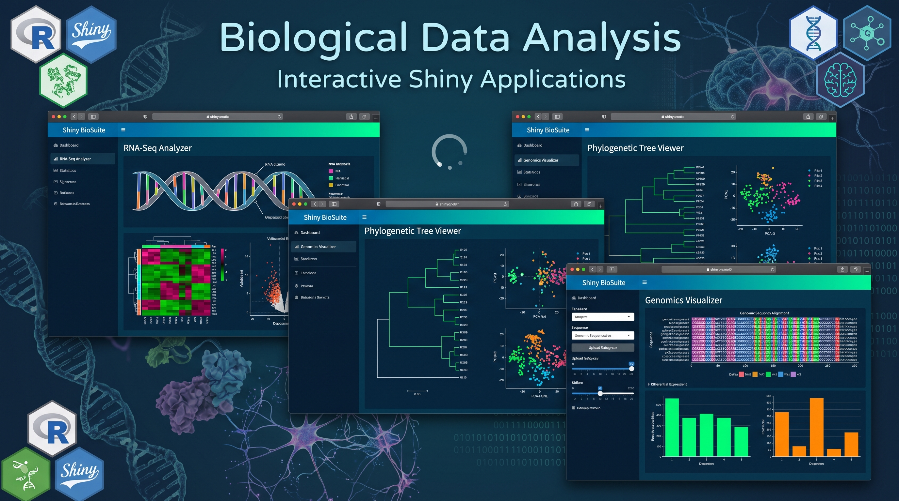

## Interactive Bioinformatics Shiny Apps

Explore a collection of interactive R Shiny applications developed for biological data analysis, multi-omics data integration, and downstream bioinformatics analysis. These tools aim to simplify complex analytical workflows through user-friendly interfaces, interactive visualizations, and reproducible computational pipelines.

**Key areas include:**
- **Biological Data Analysis:** Interactive exploration, preprocessing, and visualization of biological datasets.
- **Multi-Omics Data Integration:** Integration and interpretation of diverse biological data types.
- **Downstream Analysis:** Differential expression analysis, functional enrichment, pathway analysis, and biological interpretation.
- **Network Analysis:** Protein–protein interaction (PPI) networks and systems biology analysis.
- **Data Visualization:** Interactive plots, statistical summaries, and publication-ready visualizations.

Each application is designed to make bioinformatics workflows more accessible, efficient, and reproducible for researchers and students.

**Explore the applications below and access the corresponding source code and documentation.**
